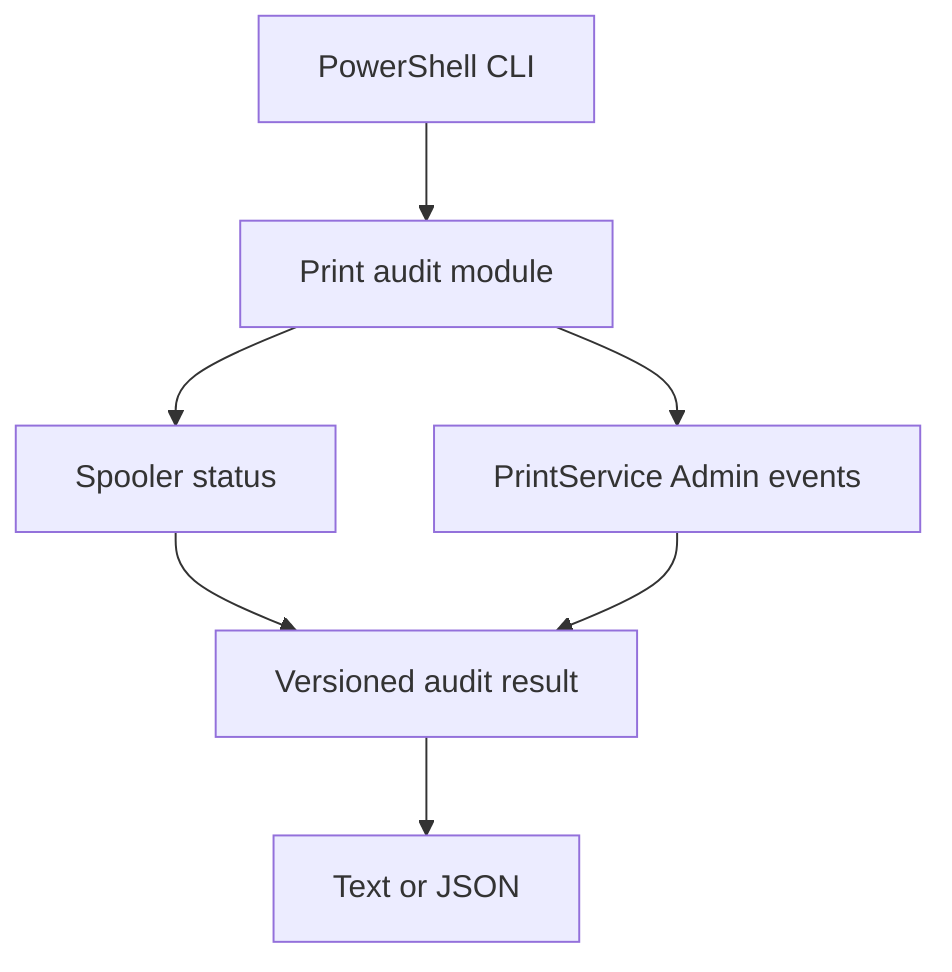

# SysHealth Toolkit

SysHealth is a read-only Windows CLI for first-line print troubleshooting. It records the local Print Spooler state and summarizes recent PrintService Admin events in a shareable report.

## Quick start

Use **Windows and PowerShell 7.4 or later** (`pwsh`). The CLI uses Windows-provided commands at runtime. Start in an ordinary PowerShell session. Access to the Spooler and its event log depends on local policy.

From the extracted project directory, run:

```powershell
./syshealth.ps1 audit -Check Print
./syshealth.ps1 audit -Check Print -Hours 24 -Format Json
./syshealth.ps1 audit -Check Print -Hours 24 -Format Json -OutputPath ./print-audit.json
$LASTEXITCODE
```

Start a standalone process with `pwsh -NoProfile -File ./syshealth.ps1 audit -Format Json` when a calling process needs the CLI exit code. When you supply `-OutputPath`, the report goes to that file. The parent directory must exist, and existing reports are preserved. Without a path, the report goes to stdout.

| Option | Default | Meaning |
| --- | --- | --- |
| `-Hours` | `24` | Lookback window in hours, from 1 to 168 |
| `-MaxEvents` | `200` | Maximum number of recent events included in counts, from 1 to 1000 |
| `-Format` | `Text` | Console-friendly text or `Json` |
| `-OutputPath` | stdout | Destination file for the selected format |

## How to read the report

- **Spooler** shows the observed Windows service state. A stopped service is a finding even if collection succeeded.
- **Events** groups records by provider and event ID and includes the most recent time for each group. If `truncated` is true, the counts describe the newest sampled events. `noEvents` means the query completed with zero matches. `unavailable` includes a reason such as `accessDenied` or `logDisabled`.
- **Coverage** is the local Spooler and the PrintService Admin channel. Use this report to identify a first lead. A running Spooler and an empty Admin log still leave printer connectivity, queue contents, and driver behavior to investigate.
- **Shareable output** includes event metadata and timestamps. It omits event messages, print job names, computer names, and usernames. [View the synthetic JSON example](examples/print-audit.sample.json).

| Exit code | Meaning |
| --- | --- |
| `0` | Both sources were collected, including a successful query with zero events |
| `2` | One source was unavailable. The report contains results from the other source |
| `1` | Both sources were unavailable, or the CLI could not run or write the report |

## Architecture



The collectors record their outcomes independently. The CLI renders the resulting report and sets an exit code based on collection completeness. Reading system state and writing a report are separate operations.

## Run the tests

On Windows with PowerShell 7.4 or later:

```powershell
Install-Module Pester -RequiredVersion 5.7.1 -Scope CurrentUser
Import-Module Pester -RequiredVersion 5.7.1
Invoke-Pester -Path ./tests -Output Detailed -CI
```

The [Windows workflow](.github/workflows/test.yml) runs the analyzer and Pester. The suite mocks collector failures and exercises the real CLI with Windows event and service APIs. To verify local permissions, run the quick start commands first as a standard user and then from an elevated PowerShell session. Compare the `spooler` and `events` outcomes for the same lookback window.

## License

[MIT](LICENSE)
